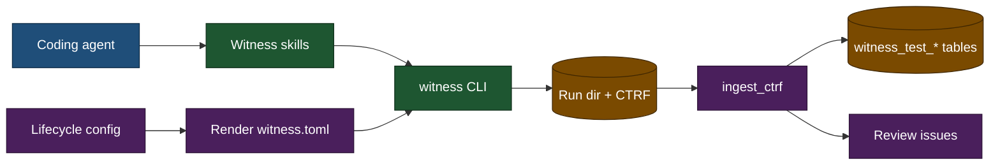

# Witness MVP: what's implemented and latest validation

Status as of 2026-11-23. Linear: ENG-10539 (sub-issues ENG-10540 to ENG-10543). All work is in local commits only; nothing is pushed.

## TL;DR

- **Witness works on eShopOnWeb, a repo it had never seen.**
  - `witness init` found the suites. The tests ran through the .NET 11 Docker image, and per-test results match the TRX files and dotnet's own totals exactly: 288 tests in 4 projects.
  - After the review fixes, all 10 injected faults get the right cause and exit code. Two of them weren't re-run after the fixes.
  - Following the skills, an agent planned and wrote tests for a real basket bug fix. Both mutation checks failed the new tests, as they should.
- **The morph integration is built and tested with fakes and local Postgres, but has not run in a real sandbox.**
  - Behind the per-project flag `witness-functional-testing`, it replaces the backend and frontend functional testers in milestone execution, review, rebase and ad hoc validation.
  - After each run, it stores the run and its per-test results and opens review issues.
  - It has not been run with a real sandbox, dev server or model. That is the next step.
- **Tests:** Witness 151/151, typecheck clean. Morph: 167 Witness-related tests pass, plus about 1,200 tests from the existing suites the change touches.
- **Two things block shipping:**
  - The PostHog flag doesn't exist yet, so CI's flag check fails.
  - Migration 202 has never been applied.

## Branches

| Linear | Repo | Branch (worktree) | Commits | Stacked on |
| --- | --- | --- | --- | --- |
| ENG-10540 run engine | witness | `eng-10540` (`~/work/witness-worktrees/eng-10540`) | 13 | `main` |
| ENG-10541 skills, plan check, lint; review fixes | witness | `eng-10541` (`~/work/witness-worktrees/eng-10541`) | 27 | `eng-10540` |
| ENG-10542 run storage, review issues, API | morph | `eng-10542` (`~/work/morph-worktrees/eng-10542`) | 5 | `origin/main` at `80aa17db4` |
| ENG-10543 sandbox wiring | morph | `eng-10543` (`~/work/morph-worktrees/eng-10543`) | 14 | `eng-10542` |
| eShopOnWeb evaluation | eShopOnWeb | `witness-eval` (`~/work/witness-targets/eShopOnWeb-witness-eval`) | 8 | upstream `aed6281` |

Each branch has a `NOTES.md` at its root with exact commands, results and gaps. The eShopOnWeb details are in [`eval/targets/eshoponweb/README.md`](../eval/targets/eshoponweb/README.md).

## How it fits together



Outside morph, a developer's agent runs the same CLI and skills. Morph adds the boxes in purple: it renders the config, and after the run it ingests the results.

## What's implemented

### ENG-10540: run engine (`packages/witness`)

- **Config:** typed `witness.toml` v1. It rejects unknown keys with a "did you mean" hint and names the exact key in every error. It supports N services, dependencies, suites, port pools and variable substitution.
- **Adapters as data** for pytest, junit-maven, junit-gradle, dotnet, jest, vitest, playwright, go, mocha, rspec, phpunit and generic. The dotnet adapter detects VSTest versus Microsoft.Testing.Platform per project.
- **Parsers** for JUnit XML, TRX, Playwright JSON, Jest JSON and `go test -json`. They tolerate broken reports and come with a corpus of 24 real report files.
- **Runner:**
  - It manages processes by process group: SIGTERM, then a grace period, then SIGKILL.
  - Real readiness checks (HTTP or a command), and services are watched for the whole run.
  - A stall watchdog, a heartbeat, and live `status.json`/`events.jsonl` files.
  - Stale runs are reaped, and runs on the same checkout are locked.
- **Reconciliation:**
  - Per-test results come only from reports Witness collected, checked against the exit codes.
  - Missing tests become `other/missing`.
  - When a report is unreadable, Witness reruns each test alone.
  - `--retries` marks tests that pass on retry as flaky.
- **Diagnosis:** every cause code in the contract, each with an evidence line from the log and concrete `try` commands.
- **`--against <ref>`:** runs the same suites a second time, either on origin services or on a temporary git worktree, and records parity for each test.
- **Commands:** `check`, `run`, `up`, `down`, `status`, `report` and `init`. Exit codes are 0 to 5 and 64.
- **Bundle:** a single-file Bun build, `dist/witness.mjs` (0.56 MB).

### ENG-10541: skills and checks

- **Six skills:** `test-change`, `plan`, `write`, `verify`, `triage` and `init`. Each is 750 words or fewer and names no harness tools; a CI script checks both.
- **`witness plan check`** validates `.witness/plan.yaml` and finds every referenced test in the suite listings. `--draft` checks a plan before its tests exist. It prints a ready `--select` command.
- **`witness lint`** has these rules:
  - `no-assertion`
  - `swallowed-exception`
  - `long-sleep`
  - plan-driven `error-status-only` and `status-only`

  It covers py, js/ts, cs, java/kt, go, rb and php.
- **`witness skills install|path|list`**, plus a Claude Code plugin layout generated from the skills (`harness/claude`; `claude plugin validate` passes).
- **`witness check --against <ref>`**, which the triage skill uses to check whether the base boots.

### ENG-10542: morph storage (`src/morph/witness_runs/`)

- **Tables:** `witness_test_runs`, `witness_test_results`, `witness_test_artifacts`, and `witness_test_issues`, which links a review issue to (project, repo, test id).
  - The Alembic migration `202_create_witness_test_runs.py` was written by hand and never run.
  - An offline comparison found 0 differences between the migration and the models.
- **`ingest_ctrf`:**
  - Validates `witness.run/v1` and writes the run and its results in one transaction.
  - It is idempotent on the Witness run id and raises on any problem. A run re-sent with different context gets a 409.
- **Queries:** "latest" is a `DISTINCT ON` query per repo, plus run listing, the results of a run and per-test history.
- **Artifacts** are stored with the FE-testing storage backend. A row is marked uploaded only after its upload succeeds.
- **Review issues:**
  - One open issue per (project, repo, test id). A repeat failure refreshes the existing issue, and a failure after the issue is resolved opens a new one.
  - Mistrials, origin-only rows, and tests an interrupted run never reached open no issue.
  - A per-repo advisory lock prevents duplicate issues.
- **API:** `POST /v1/morph/witness-runs/projects/{p}/repos/{r}` takes the CTRF report. GET routes return the latest runs, a run's results, per-test history and artifact URLs.

### ENG-10543: sandbox wiring (`src/morph/witness_testing/`)

- **Flag:** `witness-functional-testing`, scoped per project through a `{"project_ids": [...]}` payload. Windows sandboxes stay on the legacy path. With the flag off, behaviour is unchanged.
- **Renderer:** builds `.witness/witness.toml` from the lifecycle config.
  - Install and build scripts become each service's setup, run scripts its start, the healthcheck its ready check, and test scripts suites.
  - At High, origin services get `role = "origin"`.
  - Secrets appear as names only; the launcher reads their values from morph's private `env_vars.json` at run time.
  - A sha256 marker keeps agent edits of the file.
- **Vendored bundle and skills:** under `src/morph/templates/witness/` (now at `5d5e545`, which includes the review fixes), with `scripts/refresh_witness.sh` to update them.
- **Subagent:** a new short `witness_tester` subagent that follows `witness-test-change`.
  - Mid runs only the target.
  - High runs `--against origin` and reports parity.
- **Routing:** milestone execution, review, rebase and ad hoc validation use `witness_tester` instead of `be_functional_tester`, `qa_agent` and `e2e_tester`.
- **Post-run:**
  - Post-run takes the path decided at plan time, recorded in `$MCODE_DIR/witness/session.json`.
  - It ingests `.witness/runs/latest` for each writable repo, syncs issues and uploads artifacts.
  - An unfinished run is an error, not a silent skip.
- **On demand:** `run_witness_on_demand(ctx, sandbox, ...)` runs and ingests without an agent. It is a function for now, with no endpoint.

## Validation

### Unit and integration tests

| Suite | Command | Result |
| --- | --- | --- |
| Witness | `cd packages/witness && npm test` | 151/151 pass (16s); typecheck clean; `check:skills` ok |
| Morph, Witness code + template guards | `pytest tests/unit/witness_testing tests/unit/witness_runs tests/integration/witness_runs` + template, flag and model registry tests | 167 passed (rerun after re-vendoring the reviewed bundle) |
| Morph, existing suites the change touches | activities, milestone execution/review/rebase/ad hoc, upstream sync, review templates, route and security guards | 875 + 348 + 100 passed (from the review pass) |
| Morph, real eShopOnWeb report through a fake sandbox | `tests/integration/witness_runs/test_witness_sandbox_ingest.py` | 144 results stored, 2 parity differs, 6 issues, 1 artifact uploaded; re-ingest is a no-op |

Morph's integration tests use local Postgres temp tables built from the models; no migration was applied. `tests/unit/upstream_sync/test_cross_track_blocker.py` fails when run alone on these branches, but it already depended on test order before this work.

### eShopOnWeb, standalone Witness (latest run, after review fixes)

All .NET work ran in `mcr.microsoft.com/dotnet/sdk:11.0` through a wrapper (`.witness/dotnet`), because the laptop only has SDK 10.

| Check | Result |
| --- | --- |
| Baseline, 5 suites | `VERDICT passed · 291 passed, 0 failed` in 35s |
| CTRF vs TRX vs dotnet's `total:` | unit 87/87/87, integration 3/3/3, functional 54/54/54, publicapi 144/144/144 |
| Real change via skills (basket negative-quantity fix) | plan check ok (5 items); lint ok; selected run 5/5; verify `--against` base: origin passed, 289 same, 2 target_only |
| Mutation: fix reverted | P1 test fails (`Quantity must be 0 or more` not found); P2 passes on the old code too, so it was reclassified as parity |
| Mutation: negative quantities clamped to 0 | both new tests fail |

The fault injection runs below show each injected fault, what Witness reported, and the exit code:

| Fault | Outcome · cause · exit |
| --- | --- |
| required env var missing | mistrial · `missing_env` · 3 (1s) |
| wrong start project path | mistrial · `exited_before_ready` · 3. Since the review, suites that don't need the app still run |
| wrong ready URL | mistrial · `ready_timeout`, "answered HTTP 404 for 30s", not retryable · 3 (34s, was 3 min) |
| port pool taken | mistrial · `port_in_use` · 3 |
| app's fixed port held by another process | mistrial · `port_in_use` in 1s (before the review: wrong cause, `ready_timeout` after 181s) |
| test hangs 10 min | stalled · exit 4 at `stall_timeout`; advice is HangDump + `--select` (the test is not named) |
| web container killed mid-suite | mistrial · `service_died`, exit code 137 · 3 (detected within 1s)\* |
| web container paused | mistrial · `service_died` after 3 failed probes · 3\* |
| TRX truncated | `report_unreadable`, then per-test reruns; passed with `obtained: per-test-rerun` |
| compile error | error · `setup_failed`, evidence `Basket.cs(13,72): error CS1525` · 2 (was `report_missing`) |
| SIGINT | interrupted · 5; no container left behind |

\* Last run before the review fixes. The fix pass did not re-run these two.

### eShopOnWeb through morph's renderer

The config was rendered from a lifecycle config in a sandbox-like workspace and run through morph's launcher:

- **Mid:** 141 passed in 14s.
- **High (`--against origin`), with a regression visible over HTTP:** `VERDICT failed`, origin booted on its own port, and 2 parity differences on the HTTP tests.

The eval found two renderer bugs, both fixed:

- A test script's leading `cd` broke .NET runner detection.
- Origin ready probes used the target's port.

## Scope changes

Decisions made on your behalf (you hadn't answered the open questions):

- **HIGH means outcome parity:** the same tests on origin and target. Comparing response content is left for the Compare milestone.
- **Cutover is a per-project flag**, and the legacy path is unchanged while it is off.
- **No Maude setup interview:** the config is rendered from the lifecycle config, and the agent refines it with the `witness-init` skill.

Deferred or cut:

- **Not merged into Maude:** the Witness skills and Claude plugin ship from the witness repo.
- **On-demand runs are a function with no API endpoint.** An endpoint needs a new execution type.
- **Not built:** a recording proxy, the surface map, plan validation and the Compare milestone.
- **Not re-added:** the proof of concept's pre-commit lint hook.

Added beyond the contract (all backward compatible):

- **CLI:** `check --against`, `plan check --draft`, suite-qualified `--select` ids, `witness skills list`, and the `.witness/scratch/` folder in place of `/tmp`.
- **Config:** `suite.select`, `service.origin_for` and `run.kill_grace`.
- **Lint:** the `status-only` rule.
- **Morph:** the `witness_test_issues` link table, a Witness review criteria, user-or-service auth aliases, and the `session.json` file written at plan time.

Behaviour changes the review introduced:

- `ready` is now required for every service Witness starts. `{ cmd = "true" }` opts out explicitly.
- A suite where every test was skipped, or one that wrote no report but exited 0, is no longer a pass.
- Timeouts and fixture errors count as `error`, not `failed`.

Narrower than the contract:

- Review issues are opened only for runs tied to a milestone review. Local, CI and ad hoc runs without a milestone are stored but open no issues.
- Per-project rollout depends on the flag payload. Without a payload, the flag applies to every project of the tenant.

## Not verified yet, and open decisions

- **No real end-to-end run.** These have not been verified:
  - that the sandbox's Node 22 runs the bundle;
  - that the 0.56 MB skill installs through the hosted and MDv2 upload paths;
  - that the agent follows `witness_tester` with a real model.

  This is the next step: a local dev server with one flagged project.
- **The PostHog flag doesn't exist yet**, so CI's `check_feature_flags.py pr` will fail until someone creates it.
- **Migration 202 has never been applied.** RLS behaviour is untested.
- **Open decision: the ingest API accepts results from any user or service in the tenant.** Such a caller can file a run and review issues without `witness run`, which conflicts with principle 1. Options: restrict the API to `trigger=manual`, or make it service-only.
- **Open decision: post-run ingest errors are logged and returned, but they don't fail the execution or reach the user.**
- **Agents can still write `.witness/runs/` and `session.json`.** Nothing signs a run.
- **Parity from in-process tests is meaningless:** they run the target code on both sides. Only tests that call `WITNESS_<SERVICE>_URL` compare the two apps, and the renderer can't tell which tests do.
- **Witness limits:**
  - only one repo per project is rendered;
  - POSIX only, and tested only on macOS;
  - lint is regex-based;
  - MSTest listings have no class names;
  - a hung dotnet test is not named without HangDump;
  - in worktree mode, new tests always show as `target_only`.
- **Not run on eShopOnWeb:**
  - the Playwright e2e suite (its own fixture can't start the site inside the container);
  - AppHostTests (Aspire);
  - an independent agent session following the skills, rather than the build agent.

## Reproduce

```bash
# Witness
cd ~/work/witness-worktrees/eng-10541/packages/witness && npm test && npm run typecheck

# Morph (relevant tests only)
cd ~/work/morph-worktrees/eng-10543 && .venv/bin/python -m pytest tests/unit/witness_testing tests/unit/witness_runs tests/integration/witness_runs -q

# eShopOnWeb (needs Docker, the SDK 11 image and the eshop-nuget volume)
cd ~/work/witness-targets/eShopOnWeb-witness-eval
~/work/witness-worktrees/eng-10541/packages/witness/bin/witness check
~/work/witness-worktrees/eng-10541/packages/witness/bin/witness run
```
