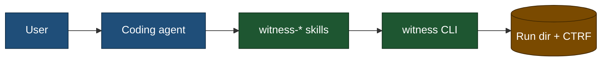

# Witness MVP: status

Status as of 2026-11-23. Linear: ENG-10539 and its sub-issues. All work is in signed local commits;
nothing is pushed.

## TL;DR

- **Standalone Witness works end to end on eShopOnWeb.**
  - Witness runs only functional tests: 3 suites, `VERDICT passed · 201 passed, 1 skipped`.
  - The Playwright e2e suite runs on the host against the app in Docker.
  - Independent agent sessions, with only the installed skills, set Witness up through an interview,
    planned and wrote tests for a real change, and verified them with `--against` the base. Every
    deliberate break of the feature failed the new tests: 12 of 12 across both evaluations.
- **Framework support is proven by a conformance kit:** 13 real projects (pytest, jest, vitest,
  mocha, playwright, junit-maven, junit-gradle, go, rspec, phpunit, dotnet-xunit, dotnet-mstest,
  bats), each through 7 scenarios. Result: 89 pass, 2 n.a., 0 fail.
- **Tests:** Witness 229/229, typecheck clean, `check:skills` ok.
- **The morph integration is paused** until standalone is in good shape. It was built against
  the pre-move Witness and needs the changes listed under [Morph side](#morph-side-paused).
- **Next:**
  - ENG-10578: several repos in one config, which lens-www needs because it tests against morph.
  - ENG-10582: a CI release step, so generated files stop being committed.

## Branches

Everything is in `morph-claude-plugin` (main clone `~/work/morph-claude-plugin`), with one worktree
per branch under `~/work/morph-claude-plugin-worktrees/`. The stack is linear; each branch starts
where the one above it ends.

| Linear | Branch | What it adds |
| --- | --- | --- |
| ENG-10571 | `eng-10571` | Witness moved from its own repo into `packages/witness`, with its history; skills ship in the `morph` plugin as `witness-*` |
| ENG-10572 | `eng-10572` | Functional tests only: required `kind`, a classifier that tells which tests drive the app, and `init` that excludes unit and integration tests |
| ENG-10573 | `eng-10573` | Adapters as presets with per-suite overrides (`list`, `${WITNESS_SELECT}`, `per_test_timeout_arg`); the conformance kit |
| ENG-10574 | `eng-10574` | eShopOnWeb re-evaluated with functional scope only; Playwright e2e on the host |
| ENG-10579 | `eng-10579` | `kind = "cli"`, plus `desktop` and `mobile` (accepted and modelled, not yet driven); `bats` adapter |
| ENG-10580 | `eng-10580` | Skills rendered per profile (`standalone`, `morph`) from one source; the plugin copy is generated |
| ENG-10581 | `eng-10581` | `init` as an agent-driven interview; `witness init --scan` facts with confidence and evidence; scan reads agent instruction files |
| ENG-10539 | `eng-10583-eval` | First end-to-end evaluation report (`E2E-EVAL.md`) |
| ENG-10585 | `eng-10585` | Fixes from that evaluation |
| ENG-10586 | `eng-10586` (worktree `eng-10585`) | `[reference]` config for `--against`; follow-up fixes; second evaluation (`E2E-EVAL-2.md`) |

Build notes per issue are in [`build-notes/`](build-notes/). The eShopOnWeb setup, wrappers and
patches are in [`packages/witness/eval/eshoponweb/`](../../packages/witness/eval/eshoponweb/README.md).

## What Witness is now



The agent drives Witness through the skills; Witness never calls a model. Results come only from
reports Witness collects itself.

- **Scope:** functional tests only, meaning tests that drive the app from outside through its
  HTTP API, a browser, its built command, a window or a device.
  - Every suite declares `kind = "api" | "ui" | "cli" | "desktop" | "mobile"`.
  - `init` leaves unit and integration tests to the project's own scripts.
  - `check` warns when a suite's files don't drive the app.
- **Framework-agnostic by construction:**
  - Adapters are presets, and each capability can be overridden per suite: report, list, select
    and per-test timeout.
  - `check` prints what each suite can do and what a missing capability costs.
  - Without a listing, Witness falls back to the tests of the last complete report.
  - The conformance kit runs in CI as a matrix.
- **Setup is an interview the agent runs.**
  - `witness init --scan` prints the repo's facts as JSON, each with a confidence and evidence:
    test projects, commands from CI, manifests, the README and agent instruction files,
    infrastructure, env and secrets, data, and what this machine has installed.
  - The `init` skill settles one decision at a time over 7 stages. "Use your defaults" skips every
    question.
  - `.witness/witness.toml` is the record; a one-line comment counts as a decision.
- **Comparisons:**
  - `--against <ref>` runs the same suites on a base and records parity per test.
  - The new `[reference]` section says how to run the app being compared with: this repo at a ref,
    or another repo by path or git URL, a `setup` step, and per-service overrides. That covers
    language migrations where the old app lives in another repo.
  - The VERDICT names a reference side that could not be compared.
- **Two skill profiles from one source:**
  - `standalone`: the user answers questions and owns commits.
  - `morph`: no one to ask, so decisions taken by default are listed under "Decisions to confirm".
  - Each skill fits in 800 words per profile.

## Validation

| What | Result |
| --- | --- |
| Witness tests | `npm test` 229/229; typecheck clean; `check:skills` ok |
| Conformance kit (`npm run conformance`) | 13 projects × 7 scenarios: 89 pass, 2 n.a. (per-test timeout in rspec and xunit), 0 fail |
| eShopOnWeb, functional scope | `VERDICT passed · 201 passed, 1 skipped` across functional (56), publicapi (143) and e2e (2 passed, 1 skipped); `r-20261123-130207-d206` |
| eShopOnWeb, `--against` the base | 200 same, 0 differ, 2 only on target (the new tests); `r-20261123-130236-a48b` |
| Agent sessions, first evaluation ([E2E-EVAL.md](E2E-EVAL.md)) | interview mostly pass; defaults mode pass; test-change failed to trigger and asked nothing; morph mostly pass |
| Agent sessions, second evaluation ([E2E-EVAL-2.md](E2E-EVAL-2.md)) | Witness-naming requests load the right skill; init asks its questions even mid-task; `[reference] setup` gives `origin passed, 0 differ`; morph lists its decisions to confirm; 6/6 mutants caught |

The second evaluation found one more Witness bug in its re-run: a setup-only `[reference]` compared
the change with itself. It is fixed, and a test covers it.

## Open

- **Low findings from the second evaluation:**
  - test-change's commit question has no options;
  - morph skips the baseline when the change is already committed (it says so);
  - `dotnet` calls the agent makes outside Witness leave build servers running.
- **Triggering:** generic prompts ("make sure it's tested") don't load Witness. That's accepted
  for now: Witness is used when a request names it.
- **Not built yet:**
  - several repos in one config (ENG-10578);
  - desktop and mobile drivers (the kinds are accepted and modelled as services or dependencies);
  - a CI release step (ENG-10582).

  Until ENG-10582, `dist/witness.mjs` and `plugins/morph/skills/witness-*` are generated files
  that stay committed.
- **Open questions from earlier issues:**
  - whether `cli` suites should default to `service = []`;
  - XCUITest on iOS vs macOS;
  - a `node --test` preset;
  - how the last-report cache is keyed;
  - MSTest `Inconclusive`;
  - gradle `--rerun` before Gradle 7.6;
  - scanning env from settings classes.
- **Limits:**
  - POSIX only, tested only on macOS;
  - lint is regex-based;
  - a hung dotnet test isn't named without HangDump;
  - in-process tests (`service = []`) test the same code on both sides of `--against`.
- **eShopOnWeb not covered:** AppHostTests (Aspire) and the unit and integration tests. That is by
  design: they stay with the project's own scripts.

## Morph side (paused)

Built and tested with fakes and local Postgres on `~/work/morph-worktrees/eng-10542` (run storage,
review issues, API) and `eng-10543` (sandbox wiring behind the `witness-functional-testing` flag).
It has never run in a real sandbox. Before it can resume:

- The renderer must emit `kind` for each suite, which is now required. It must also skip unit and
  integration test scripts.
- Re-vendor the bundle and skills with `--profile morph`, and drop the lines in `witness_tester.md`
  that the morph profile now covers (listed in [build-notes/ENG-10580.md](build-notes/ENG-10580.md)).
- Still blocking a ship:
  - the PostHog flag doesn't exist;
  - migration 202 was never applied;
  - the ingest API accepts results from any user or service in the tenant (an open decision).
- Migrations run only against a separate local Postgres for Witness evaluations, never the dev
  database.

## Reproduce

```bash
cd ~/work/morph-claude-plugin-worktrees/eng-10585/packages/witness
npm test && npm run typecheck && npm run check:skills
npm run conformance                  # the kit; Docker for the JVM and Ruby projects

# eShopOnWeb (Docker, the SDK 11 image, the eshop-nuget volume, a host SDK 11 in .witness/.env)
cd ~/work/witness-targets/eShopOnWeb-witness-eval
~/work/morph-claude-plugin-worktrees/eng-10585/packages/witness/bin/witness check
~/work/morph-claude-plugin-worktrees/eng-10585/packages/witness/bin/witness run
```
